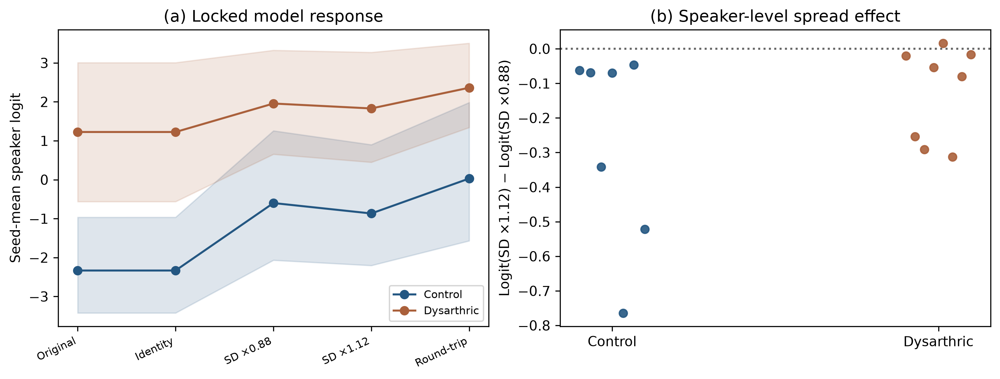
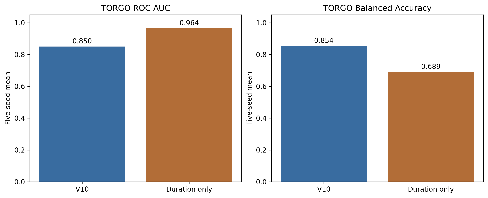
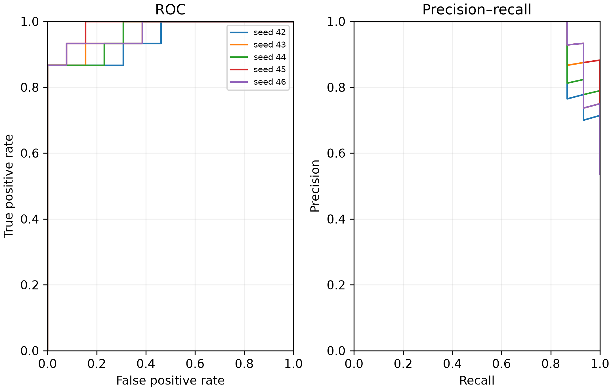
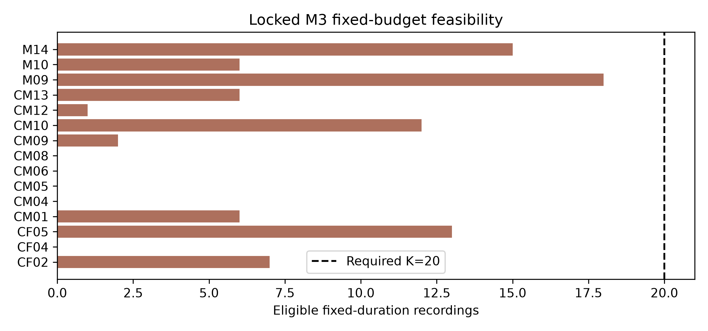

# Dysarthria detection research

This repository contains the code, executed notebooks, publication figures, and compact result tables for a sequence of dysarthria detection experiments. The main studies use speech recordings from **TORGO** for training and internal evaluation, and the official **UASpeech** corpus for locked external evaluation where the protocol permits it. The later versions focus on speaker-independent evaluation and on whether duration, recording conditions, or background audio can explain apparent discrimination.

**Start here:** Read the [V10.4 results](v10/v10.4/RESULTS.md) for the latest follow-up analyses. The [V10 publication tables and figures](v10/publication/) summarize the frozen reference model and its comparisons. The notebooks retain executed outputs, so the saved findings can be inspected without downloading the datasets.

## Repository guide

| Path | Contents |
| --- | --- |
| [`v4/`](v4/)–[`v6/`](v6/) | Historical notebook experiments and their small saved figures/results. |
| [`v7/`](v7/) | Methodology repair, grouped speaker evaluation, external validation code, and selected publication outputs. |
| [`v8/`](v8/) | Main WavLM speech-only notebook, publication workflow code, figures, and tables. |
| [`v9/`](v9/) and [`v9/v9_publication/`](v9/v9_publication/) | Active-speech experiment, generated publication products, and feasibility audit. |
| [`v10/`](v10/) | Frozen V8-preserving reference study, diagnostics, and publication products. |
| [`v10/v10.4/`](v10/v10.4/) | Latest secondary analyses, Python modules, result summaries, and figures. |
| [`tests/`](tests/) | Repository-level publication checks; V8-specific tests are under [`v8/tests/`](v8/tests/). |

The version folders are retained because later analyses refer to frozen inputs and earlier protocols. The large local artifacts were left in place on the research machine but are excluded from Git: raw corpora, downloaded dataset shards, caches, extracted embeddings, pretrained weights, checkpoints, archives, and most recording-level predictions. The committed outputs are intended for reviewing results, not for resuming a full training run from a fresh clone.

## Results and figures

The figures below are included in this repository and display directly on GitHub. ROC-AUC measures how well scores rank speakers across possible thresholds; balanced accuracy averages sensitivity and specificity at a chosen threshold. The five TORGO seeds reuse the same 15 physical speakers, so they are repeated evaluations of one small cohort.

### V10.4: threshold, duration, and background controls


The left panel shows mean balanced accuracy of **0.854** with the original threshold and **0.818** with Youden J; the paired confidence interval for the change includes zero. In the middle, adding V10 scores to a fitted duration stack raises AUC from **0.896** to **0.921**, but the gain of **0.025** has a 95% speaker-bootstrap interval of **[-0.104, 0.196]**. At right, a classifier trained on low-energy recording edges reaches **0.804 AUC** versus **0.721** for locked speech heads on the same source recordings. The paired interval includes zero, and those edges may contain speech. See the [V10.4 analysis](v10/v10.4/RESULTS.md).

### V10.4: duration-spread intervention



Changing each speaker's within-speaker duration spread shifted the model's scores: mean high-spread minus low-spread logit was **-0.192**. Yet the same-length audio-processing control produced a larger typical absolute score shift (**0.690**) than the spread comparison (**0.065**), and its AUC fell from **0.864** to **0.761**. The predeclared artifact control failed, so the intervention is **inconclusive** as evidence of a duration mechanism.

### V10: speech model versus duration-only comparator



The duration-only comparator ranks TORGO speakers better by point estimate (**0.964 AUC** versus **0.850** for V10). At their selected thresholds, V10 has higher balanced accuracy (**0.854** versus **0.689**). The paired speaker-bootstrap intervals for both differences include zero. Ranking and thresholded classification therefore tell different parts of the story, and duration remains an important potential confound. See the [paired interval table](v10/outputs/v10_2/duration_paired_speaker_bootstrap_ci.csv).

### V10: locked UASpeech M3 evaluation



Across **28 UASpeech speakers**, mean ROC-AUC is **0.966** and precision-recall AUC is **0.976**. At the locked threshold, balanced accuracy is **0.860**, sensitivity **0.720**, and specificity **1.000**: strong ranking still leaves some dysarthric speakers undetected at that threshold. This is a locked cross-corpus evaluation of a previously evaluated corpus, not a new prospective cohort. See the [M3 metric table](v10/publication/tables/table05_uaspeech_m3.md).

### V9: why its M3 result is unavailable



V9 required **20 eligible one-second recordings per speaker**. The bars show the **15 of 28** M3 speakers below that line, including several with none. Thus V9 does **not** report an M3 performance estimate under this protocol. Its evidence requirement differs from V10's; the two versions' M3 results cannot be compared as if they used the same protocol. See the [V9 feasibility audit](v9/v9_publication/README.md).

These results show discrimination under the evaluated V10 protocol, while the duration, background, and processing controls leave the source of that discrimination unresolved. A high AUC alone does not establish a clinical dysarthria mechanism. No dataset is needed to view these saved figures. For a rerun, use authorized TORGO and UASpeech copies and restore the frozen artifacts named in the version documentation. For more detail, browse the [V10 tables and figures](v10/publication/), [V9 publication outputs](v9/v9_publication/), or the executed [V10](v10/dysarthria_10.ipynb), [V9](v9/dysarthria_v9.ipynb), and [V8](v8/dysarthria_v8.ipynb) notebooks.

## Set up a local environment

Run commands from the repository root. The dependency list was developed for a local Apple Silicon environment; PyTorch device selection in the notebooks falls back to CPU when MPS is unavailable.

```bash
python3 -m venv .venv
.venv/bin/python -m pip install --upgrade pip
.venv/bin/python -m pip install -r requirements-mac.txt
.venv/bin/python -m jupyter lab
```

Set the dataset locations **before** starting a notebook kernel:

```bash
export TORGO_DATASET_PATH="/absolute/path/to/TORGO"
export UASPEECH_DATASET_PATH="/absolute/path/to/UASpeech"
```

`TORGO_DATASET_PATH` should point to the corpus folder containing `F_Con`, `F_Dys`, `M_Con`, and `M_Dys`. `UASPEECH_DATASET_PATH` should point to the official UASpeech directory with the normalized control and dysarthric channel folders. The V8 notebook documents the path defaults and other runtime options in [`v8/README.md`](v8/README.md). Set environment variables in the shell that launches Jupyter, or set them before the dataset-loading cell and restart the kernel.

For the primary historical workflow, open [`v8/dysarthria_v8.ipynb`](v8/dysarthria_v8.ipynb) and run cells in order. Its publication workflow and external evaluation require the raw corpora, the pretrained WavLM Base weights, and the local frozen-reference artifacts described in [`v8/README.md`](v8/README.md). Follow the version-specific README before attempting another version; these experiments are not interchangeable one-command runs.

The V10.4 runner is now located at:

```bash
.venv/bin/python v10/v10.4/run_v10_4.py all
```

Its stages are `audit`, `reanalyses`, `background`, `spread`, and `report`. **The move has not yet been applied to the runner's repository-root calculation or its saved source manifest**, so this command does not currently complete a rerun. Even after those paths are repaired, a fresh GitHub clone will need the frozen V8/V10 caches and checkpoints excluded from Git, plus local TORGO WAV files and WavLM weights. See [`v10/v10.4/README.md`](v10/v10.4/README.md) and [`v10/v10.4/source_manifest.json`](v10/v10.4/source_manifest.json) for the required inputs. The saved V10.4 tables and figures remain available without rerunning it.

## What GitHub contains

The `.gitignore` keeps datasets and machine-specific working files local. In particular, this repository does **not** distribute TORGO or UASpeech audio, the downloaded EasyCall data, model weights, training checkpoints, feature arrays, cache trees, or large per-recording prediction exports. Publication PNG/PDF figures, their source tables, compact metrics and audits, notebooks, and code are included. Some provenance manifests retain hashes and paths for excluded files so that a full local rerun can verify the original frozen inputs after they are restored.

The project is research software and its saved results are not a clinical diagnostic tool.
