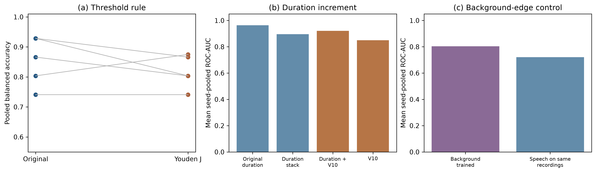

# Dysarthria V10.4: five follow-up analyses

V10.4 is a secondary, post hoc analysis of the frozen speech-only V10 detector. V8–V10.3 code and results were used only as read-only inputs. The original 15 TORGO physical speakers recur across five seeds; seeds are not independent cohorts.

## Results at a glance

| Question | V10.4 result | Interpretation |
| --- | --- | --- |
| Youden J threshold | Mean balanced accuracy 0.818 versus 0.854 original; paired Δ -0.036, 95% bootstrap [-0.096, 0.016] | No improvement under this threshold rule. AUC remains 0.850. |
| Per-fold AUC | 24/25 folds at 1.0; 1/25 at 0.5; mean seed-pooled AUC 0.850 | Each fold has two positive-negative pairs; fold results are descriptive. |
| Increment over duration | AUC 0.896 duration stack, 0.921 duration + V10; Δc 0.025, 95% bootstrap [-0.104, 0.196] | Incremental value is not established; original duration-only AUC 0.964. |
| Background-edge classifier | AUC 0.804 [0.564, 1.000] versus 0.721 [0.500, 0.900] for locked speech heads on the same source recordings; paired Δ 0.082, 95% bootstrap [-0.125, 0.311] | Background edges carry a discriminative signal, but its source is not identified. |
| Mean-preserving spread intervention | Mean logit(high SD − low SD) -0.192, 95% bootstrap [-0.296, -0.099]; verdict: **inconclusive_artifact_control** | Processing controls constrain interpretation. |

## Analysis details

### Threshold and per-fold ranking

Youden J was fitted separately to each original outer fold's 12 saved inner-OOF speaker predictions, then applied to its three untouched outer speakers. The frozen scores, epochs, and model weights were unchanged. The paired confidence interval resampled physical speakers within diagnosis and reused each draw across seeds. The 24 perfect within-fold rankings coexist with a lower pooled AUC because pooled AUC also compares scores produced by different fold models.

### Incremental information beyond duration

The duration-only and duration-plus-V10 stacks used the same fixed logistic recipe, the same original inner-OOF training speakers, and the same untouched outer test speakers. Both sets of inner predictions were already saved, and the duration scores came from the original four-statistic duration model. The direct original duration-only comparator was retained as context (AUC 0.964), and V10 alone had AUC 0.850. The small stacked Δc and its wide interval do not support a claim of disease-specific discrimination beyond duration.

### Classifier trained on background edges

A fresh WavLM-last-four speaker-attention head was fitted to the saved 750 low-energy TORGO edge embeddings under all 25 original outer folds and their speaker-held-out inner folds. Its epoch and threshold selection followed the frozen recipe. For the comparator, locked V10 speech heads scored the same 50 source recordings per speaker. These objective low-energy edges are not proven speech-free; diagnosis-correlated voice, microphone, room, or selection effects could contribute. The paired interval includes zero.

### Duration-spread intervention

Fifty recordings per speaker were chosen by a label-blind hash after fixed duration gates. Their preprocessed durations were transformed around each speaker's own mean: target = mean + α × (original − mean), with α=0.88 or 1.12. This preserves each speaker's mean and changes their within-speaker duration SD by the stated factors before sample rounding. The locked outer-fold heads scored newly extracted WavLM features for identity, low-spread, high-spread, and same-length round-trip controls. No altered audio trained a model.

Mean five-seed ROC-AUC: original 0.864, identity 0.864, low SD 0.800, high SD 0.825, round-trip 0.761. Median absolute high-versus-low logit shift was 0.065; median absolute round-trip-versus-identity shift was 0.690. The predeclared artifact gate failed. Maximum achieved-versus-target duration difference was 0.00003 seconds. No recordings were cropped in the primary manipulated conditions: 0 low-spread and 0 high-spread.

## Reproducibility and limits

Unmodified audio reproduced frozen WavLM embeddings (relative maximum difference 0.00e+00); locked rescoring reproduced all 75 published V10 probabilities (maximum difference 1.11e-16). The source manifest records SHA-256 hashes for the analysis plan and 158 frozen inputs. Every new checkpoint and result is under `v10.4/`. The five seeds repeat the same 15 speakers, so uncertainty is based on physical speakers. All V10.4 analyses are secondary; neither a high background-edge AUC nor an audio-perturbation response by itself identifies a clinical mechanism.

Run `.venv/bin/python v10.4/run_v10_4.py all` from the project root to verify the frozen inputs and resume every stage. `analysis_plan.json` fixes the analyses; `source_manifest.json` records their inputs. The `outputs/` subfolders contain per-speaker predictions, per-seed metrics, confidence intervals, and figures.
